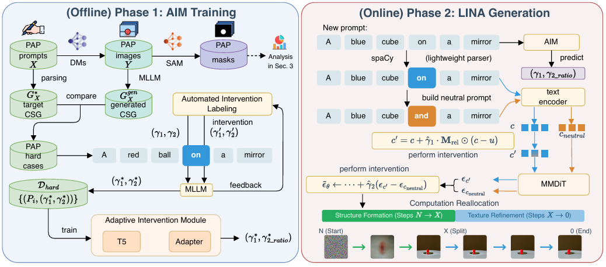
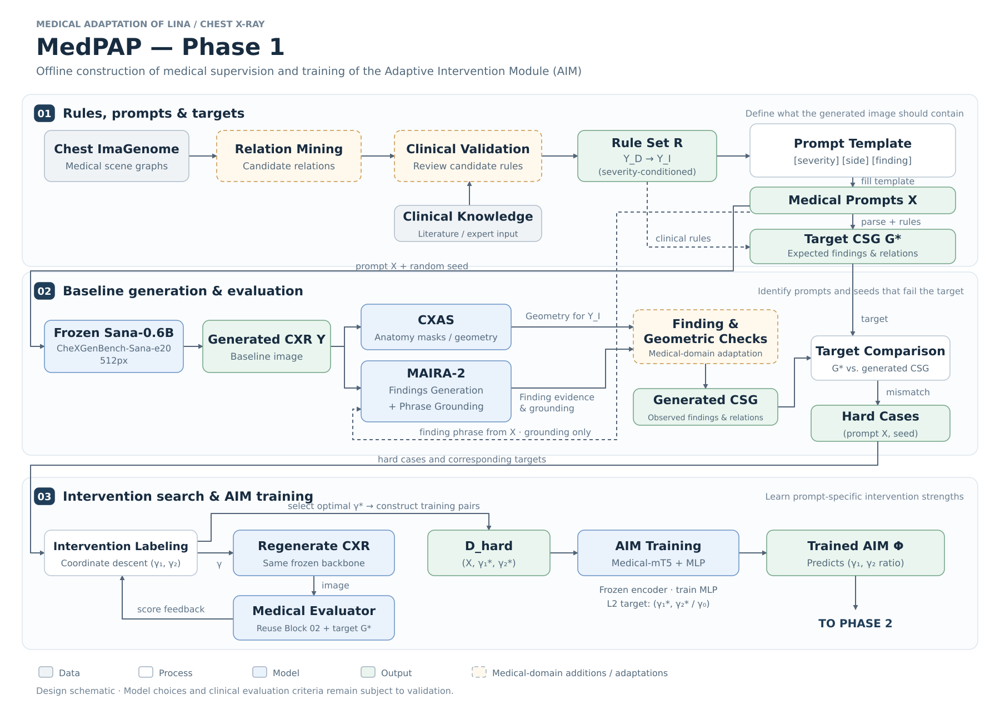
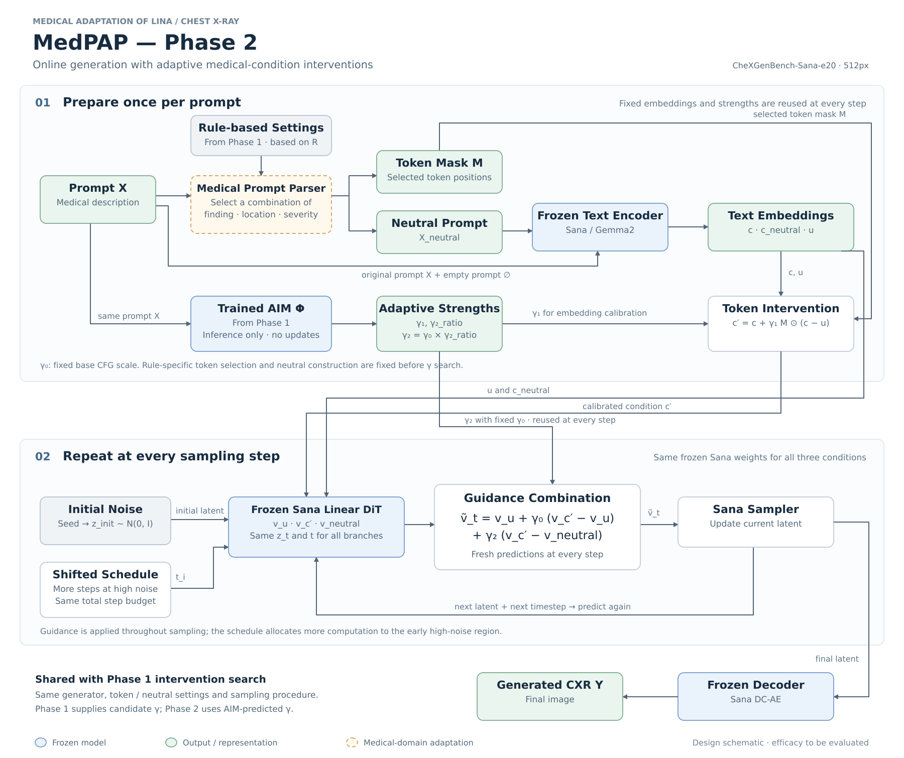

# Medical LINA — LINA를 흉부 X-ray 생성에 적용하기 위한 개인 탐색 연구

> 고려대학교 MILab 학부연구생 기간(2026.07–2026.10)에 진행한 **개인 탐색 연구**이다.
> 문제 정의와 초기 실험 단계까지 진행했고, 방법(개입·AIM) 구현 전에 종료했다.
> 논문 출판이나 성능 개선 결과는 없다.

## 요약

- **연구 질문:** 텍스트→흉부 X-ray 생성모델(Sana)은 "소견 + 좌/우 + 크기" 조건을 프롬프트대로 반영하는가?
- **한 일:** LINA를 흉부 X-ray에 옮긴 설계안(MedPAP)을 만들고, 개입 없는 기준 모델로 프롬프트 세트 01–07을 생성해 MedGemma로 판정했다.
- **현재 결론:** VLM 판정과 직접 관찰을 통해, 소견·위치·크기를 함께 지정한 복합 프롬프트에서 각 요소가 서로 섞여 반영되는 현상을 관찰했다.
  흉수·기흉을 함께 지정한 세트 07은 400장 생성과 예비 시각 검토까지 진행하고 정식 판정 전에 멈췄다.
- **구현 전:** LINA식 개입(토큰 임베딩·샘플링 개입)과 개입 강도 예측 모델(AIM)은 구현하지 않았다. 설계안까지만 있다.

## 한눈에 보기

| 항목 | 내용 |
|---|---|
| 질문 | 텍스트→의료영상 생성모델은 **여러 소견 + 위치(좌/우) + 크기** 조건을 프롬프트대로 반영하는가? |
| 참고 방법 | LINA (Yu & Lu, arXiv 2512.13290) — 관계 토큰 개입과 적응형 개입 강도 예측 |
| 생성모델 | `raman07/CheXGenBench-Models-Sana-e20` (Sana, 512px) |
| 평가 | `google/medgemma-1.5-4b-it` 로컬 GPU 추론(bf16, greedy) |
| 진행 범위 | 설계안 작성 → 기준(baseline) 생성 → MedGemma 평가 → 조건 반영 오류 탐색 |
| 미구현 | 의료 규칙 구축, 토큰·샘플링 개입, γ 탐색, AIM 학습, 방법 비교 |

## 진행 과정

1. **논문 공부:** DDPM → DDIM → CFG → LDM → DiT → Flow Matching → SD3 순서로 읽고 박사과정 멘토와 일대일 미팅에서 발표했다.
2. **방법 선정:** 자연영상에서 프롬프트의 관계·물리 조건 반영을 개선한 LINA를 참고 방법으로 정했다.
3. **설계안 작성:** LINA의 2단계 구조를 흉부 X-ray에 맞게 재구성한 **MedPAP** 도식을 만들고 멘토 피드백을 받았다.
4. **기준 실험:** 개입 없이 Sana로 프롬프트당 50장(seed 0–49)을 생성하고, MedGemma로 판정해 어떤 조건이 잘 반영되지 않는지 찾았다.

## 참고 방법: LINA



*출처: Shu Yu, Chaochao Lu. "LINA: Learning INterventions Adaptively for Physical Alignment and Generalization in Diffusion Models." arXiv:2512.13290, Figure 6. 참고용으로 인용했으며 저작권은 원 저자에게 있다.*

- **Phase 1 (offline):** 실패 사례(hard case)를 모으고, MLLM 평가를 반복하며 사례별 최적 개입 강도 (γ₁\*, γ₂\*)를 찾아 AIM(T5 + Adapter)을 학습한다.
- **Phase 2 (online):** 새 프롬프트에 대해 AIM이 γ를 예측하고, ① 관계 토큰 임베딩 개입(γ₁), ② neutral 프롬프트와의 대조 guidance(γ₂), ③ 초기 구조 형성 단계에 계산을 더 배분하는 방식으로 생성한다.

## 설계안: MedPAP (구현 전 설계)

LINA Figure 6을 흉부 X-ray 도메인에 맞게 재구성한 도식이다. 점선 주황색 상자가 의료 도메인에 맞게 추가·변경한 부분이다.

### Phase 1 — 의료 감독 신호 구성과 AIM 학습



### Phase 2 — 적응형 개입을 적용한 생성



### LINA 원본과의 차이

| 구성 요소 | LINA (자연영상) | MedPAP 설계안 (흉부 X-ray) |
|---|---|---|
| 프롬프트·목표 | PAP 프롬프트, 파싱한 목표 CSG | Chest ImaGenome 기반 관계 후보 + 임상 검토를 거친 규칙 R, `[severity] [side] [finding]` 템플릿 |
| 생성모델 | SD3.5 / FLUX 등 | CheXGenBench-Sana-e20 (frozen) |
| 평가 | SAM 마스크 + MLLM | CXAS 해부학 마스크(위치·기하) + MAIRA-2 소견 생성·grounding |
| 프롬프트 파서 | spaCy로 관계 토큰 선택 | 소견·위치·중증도 조합을 고르는 의료 프롬프트 파서 |
| AIM | T5 + Adapter | Medical-mT5(frozen) + MLP, L2 회귀 |

> 실제 초기 실험에서는 멘토 피드백에 따라 평가기로 MedGemma를 먼저 사용했다. 도식의 CXAS·MAIRA-2 구성은 이후 검증 단계를 위한 계획이다.

## 구현한 것

**생성 코드 (`generate_cxr.py`)**
입력으로 `id,prompt` 형식의 프롬프트 CSV(또는 프롬프트 한 문장)와 seed 목록을 받아, Sana 모델을 한 번 로드한 뒤 순서대로 생성한다.
`outputs/<실행시각_id>/`에 이미지(`p{프롬프트 번호}_seed{seed}.png`), 생성 설정·라이브러리 버전·GPU 정보(`run.json`), 이미지별 프롬프트·seed 기록(`manifest.jsonl`)을 저장한다.

**MedGemma 평가 코드 (`eval_*_medgemma.py`)**
입력으로 세트별 이미지 폴더(`outputs/0X_<세트명>/`)를 받는다. API를 호출하지 않고, `google/medgemma-1.5-4b-it`를 로컬 GPU에 직접 로드해 추론했다(bf16, greedy).
평가 모델에는 생성 프롬프트를 주지 않고 이미지와 고정된 질문만 준다. 결과는 `evaluations/<평가명>/responses.jsonl`에 이미지 1장당 한 줄로 저장한다. 각 줄에는 질문, 응답 원문, 모델 commit, 라이브러리 버전, 평가 시각이 들어 있다.

| 파일 | 역할 |
|---|---|
| `check_environment.py` | Python·패키지·GPU 상태 출력 (설치·다운로드 없음) |
| `generate_cxr.py` | 위 생성 코드. `--dry-run`으로 작업 목록만 확인 가능 |
| `eval_one_medgemma.py` | 이미지 1장 판정 (동작 확인용) |
| `eval_batch_medgemma.py` | 흉수 좌우·상대 크기 판정 (세트 03·04) |
| `eval_severity_medgemma.py` | 흉수 크기 3단계 × 좌우 판정 (세트 05) |
| `eval_independence_medgemma.py` | 흉수 × 심비대 독립성 판정 (세트 06), `--resume` 지원 |
| `prompts/*.csv` | 프롬프트 세트 01–07 |
| `evaluations/*/responses.jsonl` | 판정 결과 700건 (세트 03·04 200건, 05 300건, 06 200건) |

### 프롬프트 세트

| 세트 | 확인하려는 것 |
|---|---|
| 01 | 좌우 위치 기본 반영 |
| 02 | 흉수 표현 탐색 |
| 03 | 좌우 흉수 크기 조합 (작은 쪽 + 큰 쪽) |
| 04 | 03과 같은 의미, 어순만 교체 |
| 05 | 흉수 크기 3단계(small / moderate / large) × 좌우 |
| 06 | 흉수 × 심비대 2×2 (한 소견이 다른 소견을 끌고 오는가) |
| 07 | 흉수·기흉 좌우 결합 |

## 실험 결과 (MedGemma 판정 기준)

아래 수치는 **평가 모델의 판정**이며 정답 라벨이 아니다. 모든 조건은 프롬프트당 50장(seed 0–49)이다.

### 관찰: 복합 프롬프트에서 요소가 서로 섞인다

여러 소견과 위치·크기를 한 프롬프트에 함께 지정하면, 각 조건이 지정한 대상에만 반영되지 않고 서로 섞여 나타나는 경우가 있었다.
아래 세트 03·04는 이를 MedGemma 판정으로 확인한 예이고, 세트 07은 같은 현상을 다른 소견 조합에서 직접 관찰한 단계이다.

#### 세트 03·04: 좌우 크기 조건

좌우 흉수 크기를 함께 지정한 프롬프트(예: "작은 왼쪽 + 큰 오른쪽")를 생성하고, 같은 의미에서 어순만 바꾼 세트도 만들었다.

- **판정 기준:** MedGemma 응답의 `Relative size` 항목이 프롬프트에서 큰 쪽으로 지정한 방향(`right larger` / `left larger`)과 같으면 일치로 셌다.
- **분모:** 조건별 50장
- **출처:** `evaluations/effusion_order_medgemma_v1/responses.jsonl`

| 의미 | 어순 | 세트 | 큰 쪽 일치 |
|---|---|---|---:|
| 작은 왼쪽 + 큰 오른쪽 | 작은 소견 먼저 | 03 | **33/50 (66%)** |
| 작은 왼쪽 + 큰 오른쪽 | 큰 소견 먼저 | 04 | **50/50 (100%)** |
| 큰 왼쪽 + 작은 오른쪽 | 큰 소견 먼저 | 03 | 45/50 (90%) |
| 큰 왼쪽 + 작은 오른쪽 | 작은 소견 먼저 | 04 | 42/50 (84%) |

- "작은 왼쪽 + 큰 오른쪽"을 작은 소견부터 쓰면 50장 중 17장이 **왼쪽이 더 크다**고 판정됐다.
- 반대 조합에서는 어순에 따른 차이가 작았다(90% vs 84%). 따라서 "큰 소견을 먼저 쓰면 좋아진다" 같은 일반 규칙으로 말할 수는 없다.
- 다만 이 판정만으로 크기가 좌우로 뒤바뀌었다고 단정하기는 어려웠다. 그래서 크기 하나보다는 여러 조건이 서로 섞이는 현상으로 범위를 넓혀 보았다.

#### 세트 07: 흉수·기흉 좌우 결합

흉수와 기흉의 좌우 결합(단독 4개 + 결합·어순 교체 4개 = 8개 프롬프트)으로 400장을 생성했다.
예비 시각 검토까지만 했고, **MedGemma 정식 평가는 하지 않았다.** 따라서 세트 07에는 판정 수치가 없다.

### 보조 관찰 (세트 05·06)

- **크기 단독 (세트 05, 300장)**
  - 기준: 프롬프트로 지정한 쪽의 흉수 크기 판정
  - small 프롬프트에서 small 판정은 0/100(왼쪽·오른쪽 각 50장)이었고, 대부분 moderate로 판정됐다.
  - large 판정 비율은 왼쪽 41/50(82%), 오른쪽 20/50(40%)이었다.
  - 출처: `evaluations/effusion_severity_medgemma_v1/`
- **소견 독립성 (세트 06, 200장)**
  - 기준: 소견별 `present` / `absent` 판정
  - 흉수만 요청한 이미지에서 심비대 판정은 3/50, 심비대만 요청한 이미지에서 흉수 판정은 0/50이었다.
  - 흉수만 요청했는데 흉수 `absent`로 판정된 경우는 8/50이었다.
  - 출처: `evaluations/finding_independence_medgemma_v1/`

## 현재 상태

| 세트 | 상태 |
|---|---|
| 01–02 | 생성 동작·프롬프트 표현 탐색용 (판정 기록 없음) |
| 03–06 | 생성 및 MedGemma 평가 완료 (`evaluations/`에 결과) |
| 07 | **400장 생성 및 예비 시각 검토 완료, MedGemma 정식 평가 전** |
| 개입·AIM | 미구현 (설계안만 있음) |

## 한계와 배운 점

- **평가기 신뢰도:** small 판정이 거의 나오지 않는 것이 생성모델 문제인지, 평가모델의 판정 성향인지 구분할 수 없었다. 판정을 정답처럼 쓰려면 분할 기반 기하 측정 같은 독립적인 검증이 함께 필요하다.
- **도메인 지식:** 생성 결과의 임상적 타당성을 스스로 판단하기 어려웠고, 임상 규칙(R) 구축에는 전문가 검토가 필요했다.
- 이 단계에서 연구를 종료했기 때문에 개입 방법의 효과는 검증하지 않았다.

## 실행 방법

```bash
# PyTorch는 GPU·드라이버에 맞는 버전을 별도 설치
pip install -r requirements.txt
python check_environment.py

# 기준 생성 (먼저 --dry-run으로 작업 목록 확인)
python generate_cxr.py --prompts prompts/05_effusion_severity.csv --seeds $(seq 0 49) --dry-run
python generate_cxr.py --prompts prompts/05_effusion_severity.csv --seeds $(seq 0 49)

# MedGemma 판정 (모델 캐시 경로 CACHE_DIR는 환경에 맞게 수정)
python eval_severity_medgemma.py
```

- 생성 이미지(`outputs/`)와 모델 가중치는 저장소에 포함하지 않았다.
- MedGemma는 Google Health AI Developer Foundations 이용약관에 동의한 후 사용할 수 있다.

## 저장소 구조

```
.
├── README.md
├── PROJECT_PLAN.md          # 전체 구현 계획 (단계별 파일·상태)
├── check_environment.py
├── generate_cxr.py
├── eval_*_medgemma.py
├── prompts/                 # 프롬프트 세트 01–07
├── evaluations/             # MedGemma 판정 결과 (jsonl)
└── docs/figures/            # LINA Figure 6, MedPAP 설계 도식
```

## 기여 범위

- 연구 질문 설정, MedPAP 설계, 실험 설계, 코드 작성(AI 코딩 도구 활용), 실험 실행과 결과 분석은 본인이 진행했다.
- 논문 학습 방향과 설계·평가 모델 선택에 대해 MILab 박사과정 멘토의 피드백을 받았다.

## 참고문헌

- Shu Yu, Chaochao Lu. *LINA: Learning INterventions Adaptively for Physical Alignment and Generalization in Diffusion Models.* arXiv:2512.13290. [Project page](https://opencausalab.github.io/LINA)
- CheXGenBench Sana checkpoint: [raman07/CheXGenBench-Models-Sana-e20](https://huggingface.co/raman07/CheXGenBench-Models-Sana-e20)
- MedGemma: [google/medgemma-1.5-4b-it](https://huggingface.co/google/medgemma-1.5-4b-it)
